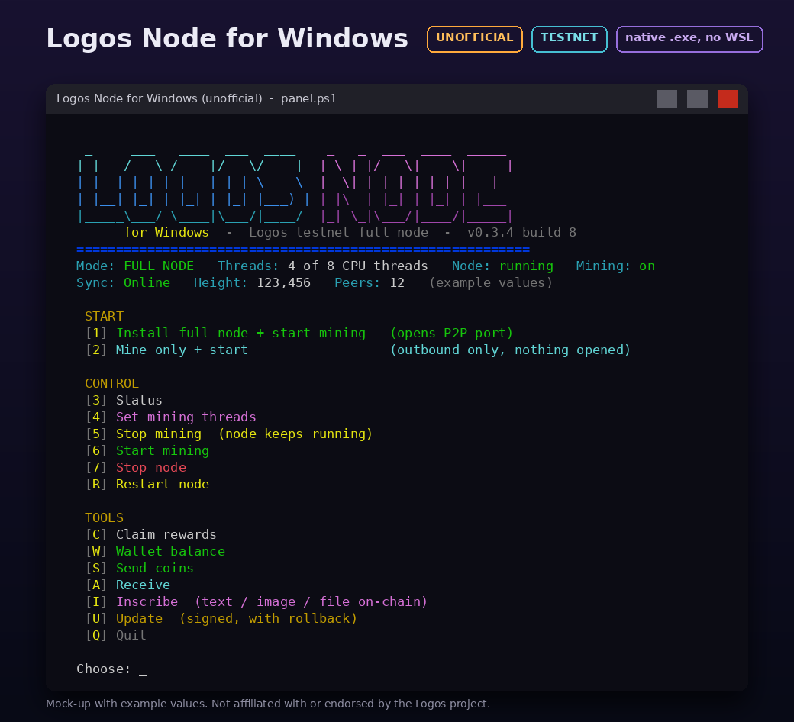

# Logos Node for Windows (unofficial)

<p align="center">
  
</p>

[](https://github.com/yayguru/logos-node-windows/releases/latest)
[](https://github.com/logos-blockchain/logos-blockchain/releases/tag/0.3.4)


[](LICENSE)


> [!WARNING]
> **Unofficial community build for the Logos testnet.** Not affiliated with, endorsed by or supported by the Logos project,
> IFT or the logos-blockchain maintainers. Provided "as is", without warranty. Testnet coins have no guaranteed value and the
> network may be reset. Only download releases from this repository's [Releases page](https://github.com/yayguru/logos-node-windows/releases)
> and check the SHA-256. See [Disclaimer](#disclaimer).

```
   _     ___   ____  ___  ____    _   _  ___  ____  _____
  | |   / _ \ / ___|/ _ \/ ___|  | \ | |/ _ \|  _ \| ____|
  | |  | | | | |  _| | | \___ \  |  \| | | | | | | |  _|
  | |__| |_| | |_| | |_| |___) | | |\  | |_| | |_| | |___
  |_____\___/ \____|\___/|____/  |_| \_|\___/|____/|_____|
        for Windows  -  native full node, no WSL, no Docker
```

**[Download the latest release](https://github.com/yayguru/logos-node-windows/releases/latest)** |
[Install](#install-users) | [Features](#features) | [Updates](#how-updates-work-signed-manifest) |
[Security](SECURITY.md) | [Build from source](#build-from-source) | [Changelog](CHANGELOG.md)

An **unofficial, community-made native Windows build of the Logos blockchain full node** (no WSL, no Docker), packaged
with a menu-driven control panel. It runs a real full node: it syncs and validates the chain, takes part in the P2P
network and can optionally mine, claim rewards, send/receive coins and inscribe data. Updates are signed and verified.

Unzip, double-click `LogosNode.bat`, and pick **full node** or **mine only** (outbound-only node, no admin rights).

> The node itself is the upstream open-source `logos-blockchain-node`, built for Windows from the
> upstream tag with a small portability patch and the node fixes listed in the changelog (see [Build from source](#build-from-source)). "Logos" is used only to
> say what the software is compatible with. For official software and support, see
> [logos-blockchain/logos-blockchain](https://github.com/logos-blockchain/logos-blockchain).

Current release: **build 11**, bundling `logos-blockchain-node` **0.3.4** (upstream tag `0.3.4`, commit `f7ab0323`) with
`build/patches/node-0.3.4-v11.patch` (PoW claims no longer stall behind this node's own block proposal). See [CHANGELOG.md](CHANGELOG.md).

> **Naming note.** Builds 1 to 8 were called "LogosMiner". Build 9 renames the launcher to `LogosNode.bat`, the settings
> file to `logos-node.ini` and the zip to `LogosNode-win64-<version>.zip`. Existing installs are migrated in place by the
> panel (see [Upgrading from LogosMiner](#upgrading-from-logosminer-builds-6-to-8)). The update manifest keeps
> `"app": "LogosMiner"` and its URL so that installed build 6 to 8 panels keep receiving updates.

## What is in the zip
| Component | Source | Licence |
|---|---|---|
| `bin\logos-blockchain-node.exe` | upstream node, tag `0.3.4`, built with MinGW-w64 | MIT OR Apache-2.0 (statically links rapidsnark and GMP, LGPL-3.0) |
| `bin\lxpost.exe` | [`lxpost/`](lxpost) in this repo: builds and signs transfers and inscriptions locally | MIT OR Apache-2.0 |
| `panel.ps1`, `LogosNode.bat`, `logos-node.ini` | [`app/`](app) in this repo | MIT |
| MinGW runtime DLLs | MSYS2 / GCC | GPL-3.0 with GCC Runtime Library Exception, winpthreads licence |

## Features
- One-click node setup: **full node** (opens the P2P port in Windows Firewall, with an optional public address) or **mine only**
  (outbound only, no admin rights, no Developer Mode).
- Mining on/off, CPU thread selection (`auto` = half of your threads), restart, status with sync, height and mining state,
  log tail, and an automatic restart if a slow PC fails to start the mining service.
- Auto-claim of mining rewards with no balance cap. The node default of 2,000,000,000 is raised to the maximum. Manual claim is also available.
- Wallet balance, **Send** and **Receive** coins, and **Inscribe** text, images or files on-chain. Every action shows the exact fee and needs
  a typed confirmation. A `--dry-run` mode is available.
- **Signed updates** (menu U): downloads only changed files, checks every hash and the release signature, backs up the old files,
  and rolls back automatically if the new node does not come up. Manual rollback is also available.
- Node 0.3.4 config migration: on first start the node converts `data\user_config.yaml` and keeps `user_config.yaml.0.3.2.bak`.
  The panel runs `--check-config` before every start, and its rollback restores the matching config.
- Hardening: the REST API is on 127.0.0.1 only, CORS is pinned to loopback, and `data\` is locked by ACL to your user, SYSTEM and Administrators.

## Install (users)
1. Download `LogosNode-win64-<version>.zip` from the Releases page and compare its SHA-256 with the published `SHA256SUMS`.
2. Unzip anywhere (for example `C:\LogosNode`) and double-click `LogosNode.bat`.
3. Choose `1` (full node) or `2` (mine only). On first start a new node identity and keystore are created in `data\`.
   **Back up `data\keystore.yaml` and never share it.**
4. SmartScreen will warn because the binaries are not code-signed: "More info" -> "Run anyway", but only for a zip you verified.

See [`app/README.txt`](app/README.txt) for the full user guide, which also ships inside the zip.

### Upgrading from LogosMiner (builds 6 to 8)
Use menu U (or `LogosMiner.bat --update`). Nothing has to be renamed by hand:
- The folder (for example `C:\LogosMiner`), `LogosMiner.bat`, `logos-miner.ini` and `data\` are left exactly as they are.
- On its first run the build 9 panel adds `LogosNode.bat` next to `LogosMiner.bat`; both start the same panel.
- The panel keeps using `logos-miner.ini` when that is the only settings file (the status screen shows which file is used).
  It never renames, copies or rewrites it, so a rollback to build 8 keeps working.
- If both files exist (for example the new zip was unzipped over an old folder), `logos-miner.ini` wins unless
  `logos-node.ini` was edited (differs from the shipped defaults).

## How updates work (signed manifest)
- The panel fetches `manifest.json` and `manifest.sig` from the update URL. The default is the project's release host; it can be changed with
  `update_url=` in `logos-node.ini` (or `logos-miner.ini` on older installs; `https://` only, or `file:///` for local tests).
- `manifest.sig` is a base64 **RSA-3072 PKCS#1 v1.5 / SHA-256** signature over the exact bytes of `manifest.json`. The panel
  checks it against the public key embedded in `panel.ps1` and refuses the update if it does not match.
- The manifest lists `path`, `sha256`, `size` and a `url` (or 20 MB `parts`) for each file. The panel only accepts paths matching
  `panel.ps1 | README.txt | version.txt | bin/*.exe | bin/*.dll` and checks each file's SHA-256 before swapping anything.
- An update only installs if its `build` number is higher than the installed `version.txt`.
- The old files go to `update\backup-<time>\`. If the node does not come back within a few minutes, they are restored.
  Build 8 also saves a copy of the config with each backup and restores it on rollback.
- The launcher (`LogosNode.bat` / `LogosMiner.bat`), the settings file (`logos-node.ini` / `logos-miner.ini`) and `data\` (keys, chain)
  are never changed by an update. The manifest path allowlist cannot reach them.

### Verify a release yourself (public key only)
```
python3 update/verify_manifest.py <folder with manifest.json, manifest.sig and the files> update/update_pub.pem
# or just the signature:
base64 -d manifest.sig > manifest.sig.bin
openssl dgst -sha256 -verify update/update_pub.pem -signature manifest.sig.bin manifest.json
```
The key in `update/update_pub.pem` is the same key embedded in `app/panel.ps1` (`$UpdPubMod` + `$UpdPubExp` = 65537).
The private signing key is held offline by the maintainers and is **not** in this repository.

## Security model (short)
See [SECURITY.md](SECURITY.md). Keys stay on your PC. Transactions are built and signed locally by `lxpost.exe`. The panel only
talks to the local node, the community explorer (Receive/Send look-ups and links) and, when you use menu U, the update host.

## Build from source
The node is built from the official upstream source with MSYS2 MinGW-w64 (`x86_64-pc-windows-gnu`). See [build/BUILDING.md](build/BUILDING.md).
In short:
1. Install MSYS2 (`base-devel git unzip mingw-w64-x86_64-{toolchain,cmake,nasm,clang,protobuf}`) and rustup with a gnu host.
2. `build/01-rapidsnark.sh`: build rapidsnark and GMP with the circuits repo's Windows recipe (`build/rapidsnark-windows/`).
3. Extract the logos-blockchain-circuits v0.5.7 Windows tarball, then run `build/02-*.sh` and `build/03-*.sh` so the shipped `.lib` files link with gnu ld.
4. `build/04-node-source.sh`: check out tag `0.3.4` and apply `build/patches/rust-rapidsnark-windows.patch`.
5. `build/05-build-node.ps1`: `cargo build -p logos-blockchain-node --release`.
6. `build/06-build-lxpost.sh`, then `build/07-pack.sh` to assemble the zip (and a signed update folder if you hold a signing key).

The only node-side change is the rust-rapidsnark patch: a `c_ulong` cast (long is 32-bit on Windows) and trimming NUL padding
from the proof string. Nothing else in the node source is modified.

## Is it open source?
Yes, with these limits stated plainly:
- **Everything in this repo is open source**: the panel, launcher, updater, `lxpost`, build scripts and the
  node patch (MIT; `lxpost` MIT OR Apache-2.0). The node is the unmodified upstream source plus
  `build/patches/rust-rapidsnark-windows.patch`.
- **LGPL components (rapidsnark, GMP) are statically linked.** To meet LGPL-3.0, the exact sources and build
  recipe are in `build/` (`01-rapidsnark.sh`, `build/rapidsnark-windows/`), and you can relink the node against your own
  build of them using the steps in [build/BUILDING.md](build/BUILDING.md). Corresponding source is also available on request
  through an issue. See `app/THIRD-PARTY-NOTICES.txt`.
- **Builds are not reproducible yet.** A rebuild from these scripts should behave the same, but its SHA-256 will not match
  the release byte for byte (toolchain versions and timestamps are not pinned). Trust rests on the published hashes and the
  signed update manifest.
- **Binaries are not code-signed** (no Authenticode certificate), so SmartScreen warns on first run.
- **`lxpost.exe` in builds 8 and 9 was built against the 0.3.2 node crates** (the transaction format it uses did not change in 0.3.4).
  It will be rebuilt against 0.3.4 in a later build.

## Help, bugs and ideas
- Bugs and feature requests: [open an issue](https://github.com/yayguru/logos-node-windows/issues/new/choose) (please include the build
  number from `version.txt` and the last lines of the log from menu 9, **never** your `data\keystore.yaml` or `data\user_config.yaml`).
- Security problems: report them privately, see [SECURITY.md](SECURITY.md).
- Problems in the node itself: [upstream logos-blockchain](https://github.com/logos-blockchain/logos-blockchain/issues).
- Contributing: see [CONTRIBUTING.md](CONTRIBUTING.md).

## Licence
The project code is under the [MIT licence](LICENSE). `lxpost/` is MIT OR Apache-2.0. Release zips also contain the upstream node
(MIT OR Apache-2.0), rapidsnark and GMP (LGPL-3.0, statically linked) and the MinGW/GCC runtime DLLs (GPL-3.0 with the GCC Runtime Library
Exception, and the winpthreads licence). All their licence texts and the LGPL relinking notes are in `app/LICENSES/` and
`app/THIRD-PARTY-NOTICES.txt` and must ship with every binary release.

## Disclaimer
Unofficial community software for the Logos **testnet**, provided "as is", without warranty of any kind (see [LICENSE](LICENSE)).
Not affiliated with or endorsed by the Logos project. Testnet coins have no guaranteed value and the network may be reset. Mining uses a lot of CPU and power. Inscriptions and transfers are
public, permanent and final. You are responsible for your keys and backups. Use at your own risk.
